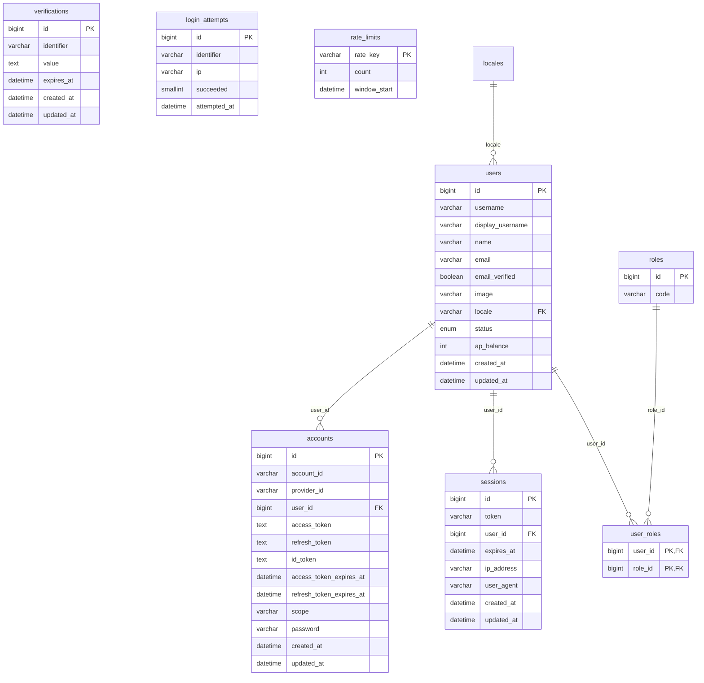
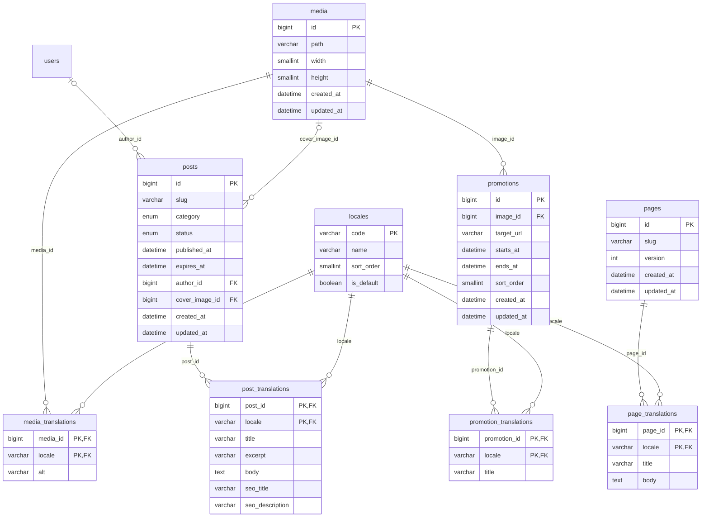
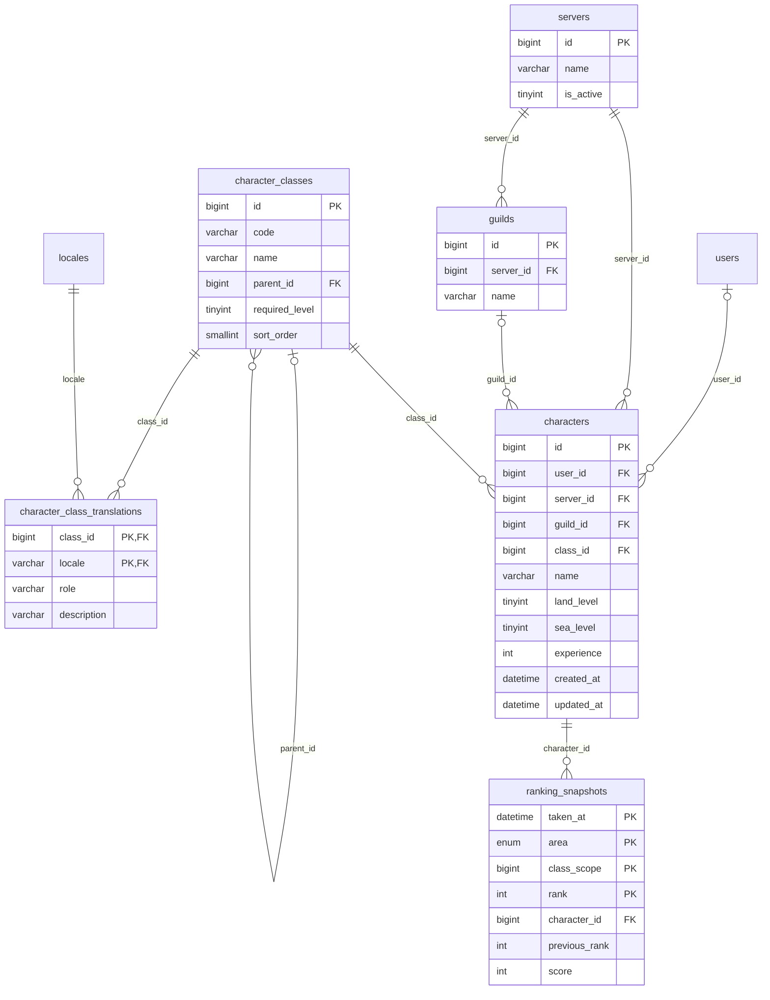
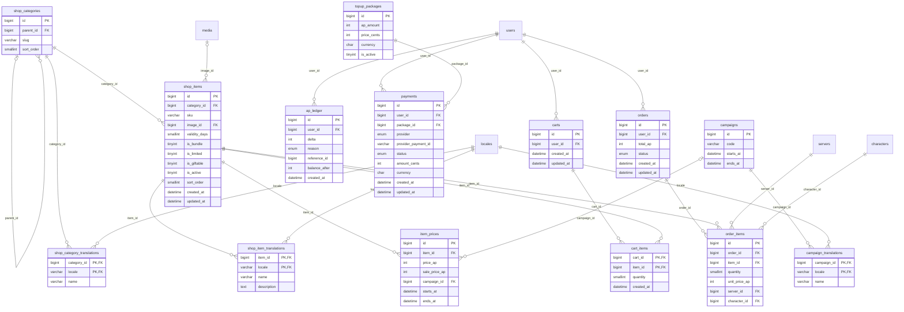
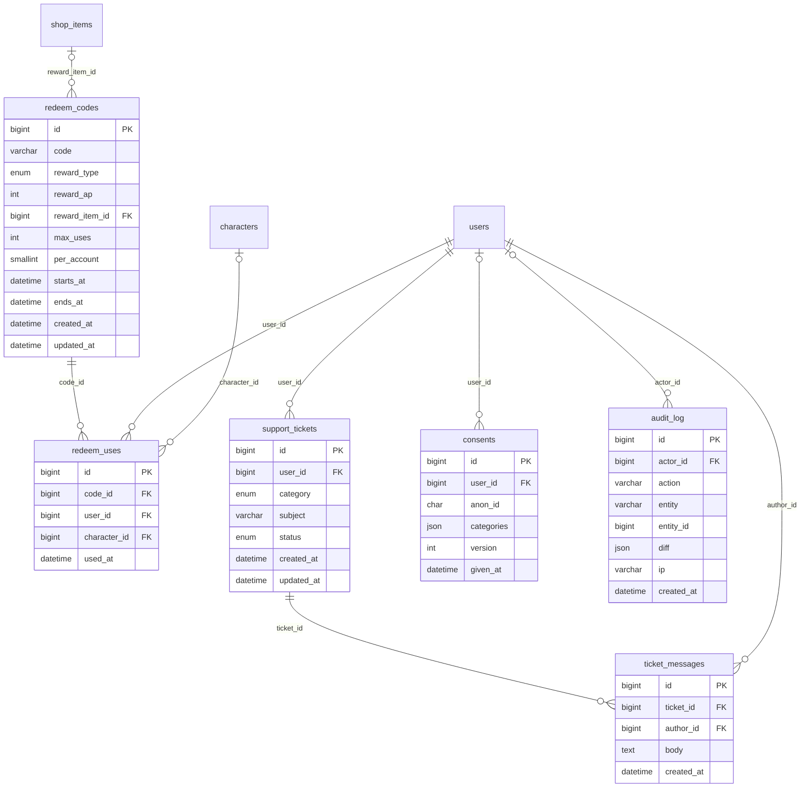

# Modelo entidad-relación

> Generado por `pnpm db:er` a partir de `src/db/schema`. No se edita a mano.

43 tablas en 5 dominios. Cada diagrama muestra las tablas de su dominio y sus claves ajenas, también las que apuntan a tablas de otros dominios (por ejemplo, `users`). Convenciones: ver [04-arquitectura §4](../plan/04-arquitectura.md).

## Identidad

## Contenido

## Juego

## Tienda y AP

## Soporte y administración

